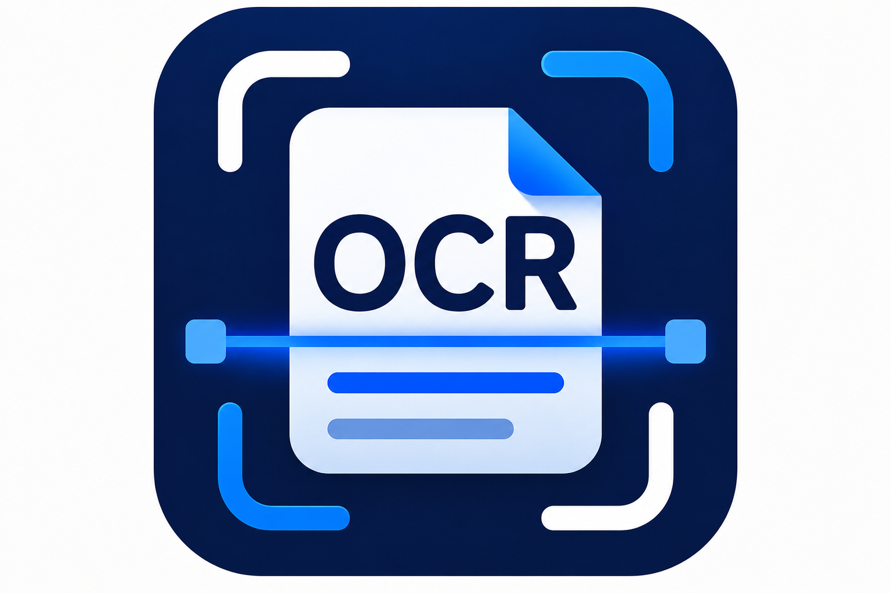
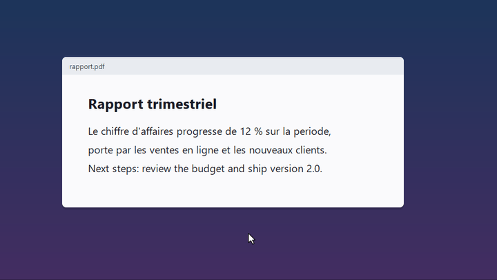

<p align="center">
  
</p>

<h1 align="center">SnapOCR</h1>

<p align="center">
  Capture de texte a l'ecran, facon Google Lens, 100 % hors ligne.<br>
  Un dossier portable pour Windows : rien a installer, aucun droit admin.
</p>

<p align="center">
  
</p>

## Utilisation

1. Telecharger le zip de la derniere [release](../../releases/latest) et le dezipper ou l'on veut (meme sur une cle USB).
2. Lancer `SnapOCR.exe` : une icone apparait dans la barre systeme.
3. **Win + Shift + O**, tracer une zone autour du texte.
4. Copier tout (**Entree**) ou glisser sur les mots puis **Ctrl + C**. Echap pour fermer.

Le clic droit sur l'icone donne acces a la capture, aux reglages, au lancement au demarrage et a Quitter.

## Points cles

- **Standalone** : Tesseract et les modeles anglais + francais sont embarques dans le dossier.
- **Hors ligne** : aucune connexion, l'image ne quitte jamais la machine.
- **Selection fine** : le texte reconnu se superpose a l'image, on choisit les mots a la souris (Shift etend, Ctrl ajoute).
- **Zone ajustable** : les poignees du cadre relancent l'OCR.
- **Multi-ecrans et haute resolution** pris en charge.

## Configuration

Les reglages (fenetre Configuration du menu) sont stockes dans `%APPDATA%\SnapOCR\config.json` :

| cle              | defaut        | role                                      |
|------------------|---------------|-------------------------------------------|
| `hotkey`         | `win+shift+o` | raccourci global (ex : `ctrl+shift+o`)    |
| `lang`           | `eng+fra`     | langues Tesseract                         |
| `min_confidence` | `30`          | confiance minimale (0-100) pour garder un mot |

Si le raccourci est deja pris, SnapOCR bascule sur `ctrl+shift+o` et le signale.

## Developpement

Python 3.12, `pip install -r requirements.txt`, puis :

```powershell
build\fetch_assets.ps1      # une fois : Tesseract + modeles dans snapocr\resources\tesseract\
python -m snapocr           # lancer depuis les sources
build\build.ps1             # dossier portable dans dist\SnapOCR\
python build\make_demo_gif.py   # regenerer docs\demo.gif
```

`fetch_assets.ps1` copie Tesseract depuis une installation msys2 (`MSYS2_ROOT`, `C:\msys64` par defaut).
`build.ps1` utilise le Python du PATH, ou celui de `SNAPOCR_PYTHON`.

Publication (token lu dans Git Credential Manager) :

```powershell
python publish_github.py                                        # apercu, rien n'est envoye
python publish_github.py --push -m "message"                    # pousser les modifs
python publish_github.py --push -m "SnapOCR v0.2.0" --release v0.2.0   # + release avec l'exe
```

## Licence

[MIT](LICENSE). Tesseract (embarque dans les releases) est sous Apache 2.0, PySide6 sous LGPLv3.
